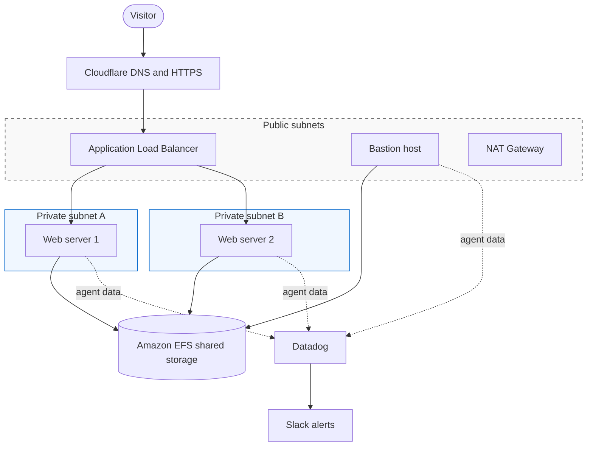

# Highly Available Two-Tier Clinic Website on AWS

A clinic website (**Moses Medilab**, live at `clinic.vickieskitchen.online`) hosted on a highly available, two-tier AWS architecture. A public tier (load balancer, bastion host, NAT gateway) fronts a private tier (Auto Scaling web servers sharing Amazon EFS storage). Datadog monitors every server and sends CPU alerts to Slack.

## What this project demonstrates
- A custom VPC with public and private subnets across two Availability Zones
- Web servers with **no public IPs**, reachable only through the load balancer or the bastion host
- **Shared content** through encrypted Amazon EFS, so every server serves identical files
- **Self-healing compute**: a launch template and an Auto Scaling Group replace failed servers
- HTTPS with DNS and certificate handled by Cloudflare (Route 53 and ACM were not available on the account; see the comparison in [DNS and HTTPS](docs/06-dns-https-cloudflare.md))
- Monitoring and alerting with Datadog and Slack
- A documented troubleshooting record of real problems and their fixes

## Architecture

## Services used

| Service | Purpose |
| :--- | :--- |
| Amazon VPC | Isolated network with public and private subnets |
| Internet Gateway | Internet access for the public subnets |
| NAT Gateway | Outbound-only internet access for private servers |
| Security Groups | Layered network access control between tiers |
| Amazon EC2 | Bastion host and Ubuntu/Nginx web servers |
| Launch Template | Repeatable server configuration through user data |
| Auto Scaling Group | Keeps the right number of healthy web servers |
| Application Load Balancer and Target Group | Distributes traffic and checks server health |
| Amazon EFS | Encrypted shared storage for the website files |
| Namecheap | Domain registration |
| Cloudflare | DNS and free HTTPS certificate |
| Datadog | Infrastructure monitoring and CPU monitor |
| Slack | Alert notifications |

## Documentation

1. [Network (VPC, subnets, gateways, routes)](docs/01-network.md)
2. [Security groups](docs/02-security-groups.md)
3. [EFS and bastion host](docs/03-efs-and-bastion.md)
4. [Launch template, Auto Scaling and load balancer](docs/04-compute-and-load-balancer.md)
5. [Datadog and Slack](docs/05-datadog-and-slack.md)
6. [DNS and HTTPS with Cloudflare](docs/06-dns-https-cloudflare.md)
7. [Validation](docs/07-validation.md)
8. [Troubleshooting log](docs/08-troubleshooting.md)
9. [Lessons learned and next steps](docs/09-lessons-and-next-steps.md)

The server startup script is in [`scripts/user-data.sh`](scripts/user-data.sh).

## Highlights from the troubleshooting log
- EFS mounts timed out because the EFS security group had no NFS (port 2049) rule.
- Targets showed unhealthy (HTTP 403) because EFS had failed to mount at launch, leaving Nginx an empty folder.
- The Datadog agent install was killed by the out-of-memory killer on 1 GB servers, fixed with swap and a larger instance type.

Full details are in the [troubleshooting log](docs/08-troubleshooting.md).

## Author
**Oladeji Moses**

Cloud and DevOps learner. This project was built as part of my hands-on cloud learning.
